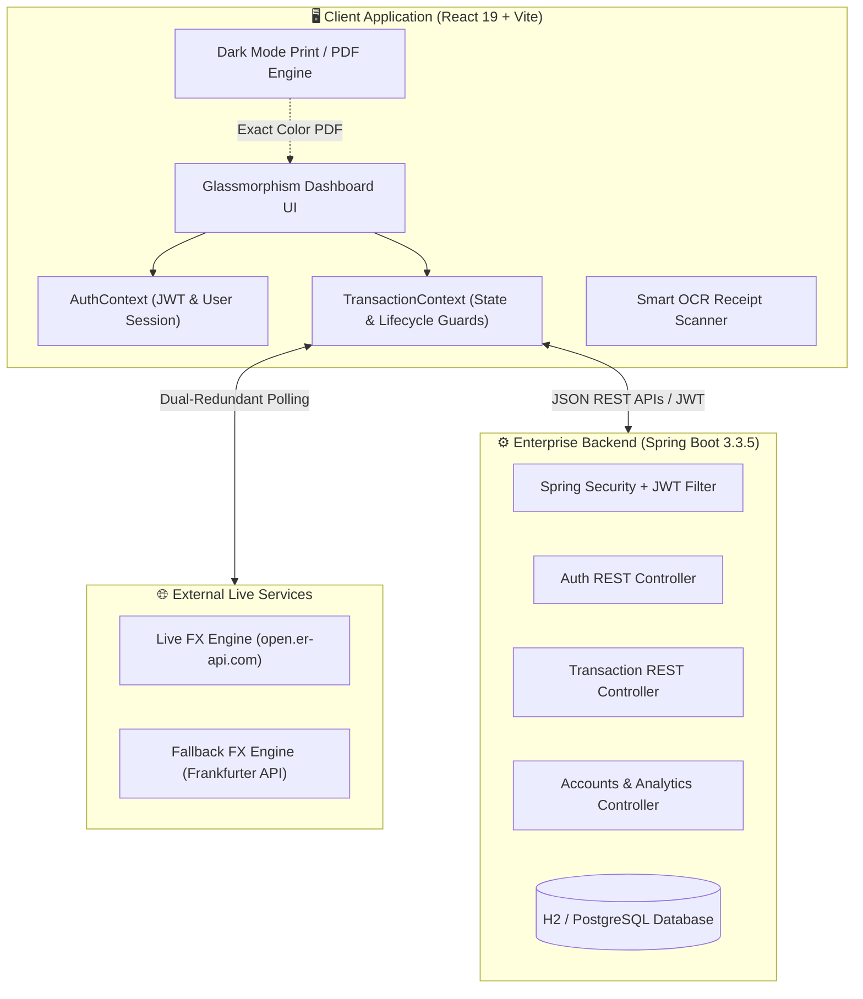

<div align="center">

# 💎 FinTrack PRO
### Enterprise-Grade Personal Finance, FX Currency Engine & Wealth Intelligence Platform

[](https://react.dev/)
[](https://spring.io/projects/spring-boot)
[](https://vitejs.dev/)
[](https://tailwindcss.com/)
[](https://www.oracle.com/java/)
[](LICENSE)

<p align="center">
  <b>A comprehensive, high-performance financial management suite engineered for total cash flow clarity, live foreign currency conversions, custom wealth milestones, and executive dark-mode statements.</b>
</p>

[Explore Features](#-core-features) • [System Architecture](#-system-architecture) • [Getting Started](#-getting-started) • [API Specification](#-api-specification) • [License](#-license)

---

</div>

## 📌 Executive Summary

**FinTrack PRO** is a full-stack personal finance application built to replace fragmented spreadsheets and clunky budgeting tools. Designed around speed, privacy, and visual elegance, it combines real-time global FX rate conversions, OCR receipt parsing, group bill splitting, and custom wealth milestones into a unified, obsidian-dark dashboard.

Unlike standard templates that force static mock records, FinTrack PRO operates with a **Clean-Slate Default**: new accounts start clean with zero transactions, allowing users to build and own their financial profile with 100% persistent storage across page refreshes and log-out/log-in cycles.

---

## ✨ Core Features

| Feature | Description |
| :--- | :--- |
| 💱 **Live Multi-Currency FX Engine** | Dual-redundant real-time FX rate integration (`open.er-api.com` with automated fallback to `api.frankfurter.dev`). Dynamically converts all balances, transactions, and category budgets across **INR (₹)**, **USD ($)**, **EUR (€)**, **GBP (£)**, **JPY (¥)**, **CAD ($)**, and **AUD ($)**. |
| 🎯 **Custom Wealth Milestones** | Clean-slate savings target tracker. Create custom goals (Emergency Vault, Vacation, Tech Upgrades, Real Estate, Vehicle), monitor progress bars, and deposit funds with celebratory confetti animations. |
| 📄 **Executive Dark Statement (PDF)** | Generates institutional-quality monthly wealth audits. Built with `-webkit-print-color-adjust: exact` to preserve the signature **obsidian dark palette (`#020617`)** in printed/PDF outputs, with high-contrast typography optimized for monochrome and black & white printing. |
| 💳 **Multi-Account & Liquidity Hub** | Track checking accounts, high-yield savings (HYSA), credit cards, and cash wallets with real-time balance recalculation on every income or expense entry. |
| 🧾 **OCR Digital Receipt Scanner** | Built-in smart receipt scanner (PNG, JPG, PDF) with client-side text extraction to automatically parse merchant names, dates, and amounts. |
| 👥 **Group Bill Splitting** | Seamlessly calculate group dinners, trips, and shared household bills with custom per-person breakdown and settlement tracking. |
| 📊 **Interactive Cash Flow Analytics** | Powered by Recharts: dynamic income vs. expense bar charts, category utilization dials, and real-time budget variance alerts. |
| 🔒 **Bulletproof Data Persistence** | Protected by synchronous lazy state initializers and lifecycle memory guards. Records are never wiped during page reloads, browser restarts, or log-out/log-in cycles. |
| 🌓 **Glassmorphic UI & Sliding Auth** | Modern sliding carousel authentication gate with smooth CSS keyframe animations, animated tab indicator, password visibility toggle, and anti-FOUC instant dark theme loading. |

---

## 🏛️ System Architecture



---

## 📂 Project Structure

```text
finance-tracker/
├── client/                          # React 19 + Vite Frontend
│   ├── src/
│   │   ├── components/
│   │   │   ├── LoginPage.jsx        # Sliding carousel login & register UI
│   │   │   ├── Navbar.jsx           # Global nav, FX pill, notification center
│   │   │   ├── StatsCards.jsx       # Real-time liquid net worth & cash flow cards
│   │   │   ├── ChartsSection.jsx    # Recharts dynamic income vs expense charts
│   │   │   ├── AccountsSection.jsx  # Multi-account management & cards
│   │   │   ├── SavingsGoalsSection.jsx # Custom wealth milestones & deposit modal
│   │   │   ├── BudgetSection.jsx    # Monthly category limits & variance bars
│   │   │   ├── TransactionList.jsx  # History table, search, categorization & filters
│   │   │   ├── StatementModal.jsx   # Executive statement generator & dark PDF print
│   │   │   ├── ReceiptScannerModal.jsx # OCR receipt scanner
│   │   │   └── SplitBillModal.jsx   # Group bill splitting calculator
│   │   ├── context/
│   │   │   ├── AuthContext.jsx      # Authentication & currency state
│   │   │   └── TransactionContext.jsx # Protected persistent storage & business logic
│   │   ├── utils/
│   │   │   └── formatters.js        # Currency formatter & live FX engine
│   │   ├── index.css                # Obsidian design system, keyframes & print rules
│   │   └── App.jsx                  # Main dashboard layout
│   └── package.json
│
├── src/main/java/com/fintrack/      # Spring Boot 3.3.5 Backend
│   ├── controller/                  # REST API endpoints (Auth, Transactions)
│   ├── model/                       # JPA entities (User, Transaction, Account)
│   ├── repository/                  # Spring Data JPA repositories
│   ├── security/                    # JWT token provider & Security filters
│   └── service/                     # Business logic & financial services
├── pom.xml                          # Maven dependencies & build configuration
└── README.md
```

---

## 🚀 Getting Started

### Prerequisites
* **Node.js**: v18.0.0 or higher
* **Java JDK**: 17 or 21
* **Maven**: 3.8+

---

### 1. Installation

Clone the repository to your local machine:
```bash
git clone https://github.com/your-username/finance-tracker.git
cd finance-tracker
```

### 2. Run the Frontend (Vite Client)
```bash
cd client
npm install
npm run dev
```
The frontend will start instantly at: **`http://localhost:5173`**

### 3. Run the Backend API (Spring Boot)
```bash
# From the project root directory
mvn spring-boot:run
```
The backend REST API will run on: **`http://localhost:8080`**

*(Note: If running in standalone frontend mode, FinTrack PRO automatically runs in local simulation mode with persistent storage enabled.)*

---

## 🔌 API Specification

| Method | Endpoint | Description | Auth Required |
| :--- | :--- | :--- | :---: |
| `POST` | `/api/auth/register` | Register a new user account | No |
| `POST` | `/api/auth/login` | Authenticate and obtain JWT token | No |
| `GET` | `/api/transactions` | Fetch user-scoped transactions list | Yes |
| `POST` | `/api/transactions` | Record a new transaction (Income/Expense) | Yes |
| `PUT` | `/api/transactions/{id}`| Update an existing transaction | Yes |
| `DELETE`| `/api/transactions/{id}`| Remove transaction and update account balance | Yes |
| `GET` | `/api/accounts` | Retrieve all bank accounts and balances | Yes |
| `GET` | `/api/health` | Health check status endpoint | No |

---

## 🎨 Design Philosophy & UX Highlights

* **Obsidian Slate Palette**: Handcrafted with deep obsidian (`#020617`), dark navy (`#0b0f19`), vibrant emerald (`#10b981`), and rose accents.
* **Anti-FOUC Dark Theme**: Zero flash-of-unstyled-content on page reloads with inline theme bootstrap.
* **Celebration Confetti**: Dynamic particle physics trigger when savings milestones are achieved or large income entries are recorded.
* **True-Color Print**: Executive PDF exports retain rich dark aesthetics rather than stripping backgrounds to bare white.

---

## 📄 License & Copyright

Distributed under the **MIT License**. See `LICENSE` for more information.

<div align="center">
  <p>© 2026 <b>FinTrack PRO</b>. All rights reserved.</p>
</div>
